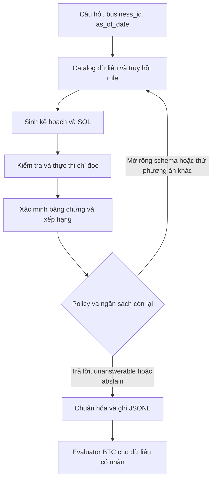

# Các bài toán con và thiết kế harness

Harness là phần đọc dữ liệu, cung cấp công cụ, quản lý ngân sách, thực thi, ghi trace và xuất bài nộp. Generator, verifier và decision policy có thể thay riêng qua các interface. Thiết kế dưới đây dùng một model local với SQL làm đường thực thi đầu tiên. Chọn SQL engine và thư viện đọc Excel sau khi xem mẫu train, ưu tiên một engine có dialect cố định và adapter kiểm thử được.

## Tách bài toán để xử lý từng bước

Các hàng là nhóm kỹ thuật đề xuất để gán lỗi và chọn mẫu thử. Tần suất và thứ tự ưu tiên sau hai hàng đầu cần đo trên train.

| Bài toán con | Cách làm đầu tiên | Một phép thử độc lập |
| --- | --- | --- |
| Đọc CSV, Excel, SQLite | Giữ nguồn file/sheet/table, kiểu gốc và kiểu suy luận. Phân biệt null, rỗng, 0, mã có số 0 đầu, ngày Excel và số có dấu phân tách. Cache catalog từng doanh nghiệp. | Cùng một bảng tổng hợp nhân tạo lưu ở ba định dạng cho cùng kết quả. |
| Hợp đồng đáp án | Một serializer kiểm tra `type`, giá trị, JSONL và ID. Chuẩn hóa theo evaluator. | Fixture đủ kiểu, cả percent âm, list đảo thứ tự, bảng đảo hàng và hai kiểu từ chối. |
| Tra cứu schema và thực thể | Match tên trường, alias, mã và giá trị mẫu từ gói hiện tại. Lấy cả bảng liên quan và khóa join. Giữ dấu trong giá trị trả về. | Hai sản phẩm cùng tên gần giống. Chọn theo mã hoặc căn cứ trong dữ liệu, ghi nhận mơ hồ nếu có. |
| Thời gian và lịch | Parse khoảng từ `as_of_date` và rulebook. Dùng biên nửa mở `[start,end)` cho timestamp khi hợp quy tắc. Tra lịch cung cấp cho câu hỏi âm lịch. | Ngày đầu tháng, giao năm, mốc âm lịch, bản ghi ngay sát hai biên. |
| Tra cứu, lọc và tổng hợp | Một SQL đọc. Phân biệt `COUNT(*)`, đếm thực thể phân biệt và `SUM`. Đưa đơn vị và cách xử lý null vào kế hoạch. | Hai dòng cùng đơn, một đơn hủy, một giá trị null. |
| Join và phép tính nghiệp vụ | Gắn tên rule và grain trước khi join. Kiểm tra khóa, fan-out và tính đủ dữ liệu cho doanh thu, giá vốn hoặc công nợ. | Một hóa đơn có nhiều dòng và nhiều khoản thanh toán. Kiểm tra tổng sau tiền tổng hợp. |
| Top-k, so sánh và đầu ra nhiều giá trị | Chốt tiêu chí, đơn hợp lệ, tie-break và thứ tự đáp án. Khóa công thức phần trăm và xử lý mẫu số bằng 0 theo rulebook. | Ca ít hơn k, hòa nội bộ và so sánh với kỳ gốc bằng 0. |
| Thiếu căn cứ | Theo dõi trường bắt buộc, độ phủ thời gian và bằng chứng rule. Tách query rỗng hợp lệ, thiếu dữ liệu, lỗi parser, timeout. | Thiếu bảng giá vốn so với có giá vốn và lợi nhuận đúng bằng 0. |

## Interface tối thiểu

| Thành phần | Đầu ra đề xuất |
| --- | --- |
| `catalog` | Danh mục cột, kiểu, alias, nguồn, khóa, profile null/cardinality và mẫu có giới hạn. Cache theo gói dữ liệu và phiên bản loader. |
| `retrieve` | Schema và đường join ứng viên, rule/đoạn README cùng nguồn, ví dụ few-shot chỉ từ tập fit hoặc dữ liệu tự tạo hợp lệ. |
| `generate` | Một hoặc vài ứng viên có intent, khoảng ngày, metric, filter, loại output dự kiến, SQL và các giả định cần kiểm tra. Bước đầu giữ SQL làm chương trình chính để giảm công triển khai DSL. |
| `execute` | Trạng thái thực thi, bảng kết quả có kiểu, lỗi, số hàng và thời gian. Tách dữ liệu khỏi instruction, kể cả nội dung trong cell và README. |
| `verify` | Hard checks và tín hiệu xếp hạng. Kiểm tra cột và đơn vị, grain, phạm vi ngày, thực thể, rule và độ nhất quán giữa các phương án thực sự khác nhau. |
| `decide` | `answer`, `unanswerable`, `abstain` hoặc một hành động lấy thêm bằng chứng trong ngân sách còn lại. |
| `run` | Một dòng hợp lệ mỗi ID, ghi tăng dần để giữ các kết quả đã có khi dừng sớm. Writer duy nhất hoặc merge có thứ tự ổn định. Resume theo ID đã ghi hợp lệ và cùng config/data hash. |

Executor bản đầu nhận một statement truy vấn qua allowlist/AST và chạy trong worker chỉ đọc theo gói hiện tại. Chặn lệnh ghi, attach, đọc file tùy ý, extension và các đường gọi ngoài phạm vi. Dùng giới hạn thời gian, bộ nhớ và số hàng. Nếu có bước Python sau này, chạy trong worker cô lập và coi toàn bộ code sinh là đầu vào chưa tin cậy. Docker offline là ràng buộc nộp bài, còn việc cô lập worker giúp một câu lỗi không làm hỏng cả lượt chạy.

Trace nội bộ lưu ID, phiên bản rule/catalog, bảng/cột được lấy, plan và SQL, kết quả check, lỗi theo stage, quyết định cuối, latency/token và seed. Giới hạn dữ liệu thô trong log. Tách output nộp và output phân tích. Xác nhận định dạng log BTC yêu cầu trong Docker Guide và tab Data.

## Ví dụ xuyên suốt

Giả sử shop có bảng `orders(order_id, sold_at, status)` và `order_lines(order_id, sku, qty, unit_price)`. Câu hỏi “Tháng trước bán được mấy ly trà đào?” với `as_of_date = 2026-03-04` đi qua các bước sau:

1. Catalog xác định grain đơn và dòng sản phẩm. Retriever giữ cả khóa join `order_id`, mã sản phẩm, số lượng, trạng thái, ngày và rule về đơn hợp lệ.
2. Parser tạo khoảng `[2026-02-01, 2026-03-01)` theo giả định “tháng trước” là tháng dương lịch liền trước. Entity linker xác định `sku` qua catalog sản phẩm của shop.
3. Generator có thể tạo hai SQL đều chạy được. A dùng `SUM(qty)`, B dùng `COUNT(*)`. Nếu có hai dòng với số lượng 2 và 3, kết quả là 5 và 2. Verifier dùng cụm “mấy ly”, đơn vị và grain dòng hàng để ưu tiên A.
4. Nếu mapping `sku` còn mơ hồ, policy có thể truy thêm catalog rồi chạy lại. Nếu chứng minh được dữ liệu thiếu số lượng và rule không cho suy ra, chọn `unanswerable`. Nếu chỉ còn timeout hoặc bằng chứng yếu, chọn `abstain`.

Thử nghiệm này kiểm riêng ba nguyên nhân mất điểm. Retriever có bỏ sót `qty` không? Generator có sinh phương án A không? Verifier và policy có chọn A khi cả hai phương án đều chạy không?
