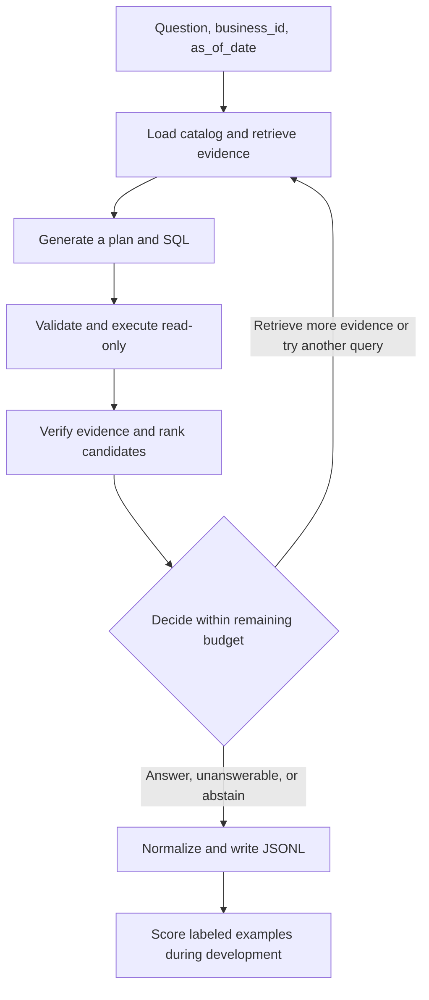

# Agent harness design

The harness loads business data, exposes query tools, enforces resource limits, records traces, and writes the submission. The generator, verifier, and decision policy have separate interfaces so each can be evaluated independently. The implementation uses Polars/Fastexcel for Rust-backed CSV and Excel ingestion, Apache DataFusion for Rust-backed SQL, and `mistralrs` for local GGUF inference. SQLite files are read-only ingestion sources and their tables are registered in the in-memory DataFusion catalog.

## Subproblems and fixtures

Start with data loading and answer serialization. Use errors on the training split to prioritize the remaining components.

| Subproblem | First implementation | Isolated check |
| --- | --- | --- |
| Load CSV, Excel, and SQLite | Track the source file, sheet or table, and both source and inferred types. Distinguish nulls, empty strings, zeros, codes with leading zeros, Excel dates, and locale-specific numbers. Cache the catalog by data package. | Store the same synthetic table in all three formats and compare the typed results. |
| Serialize answers | Use one serializer to validate the ID, `type`, and answer value. Apply the evaluator's normalization rules at the output boundary. | Cover all types, including negative percentages, reordered lists, reordered table rows, `unanswerable`, and `abstain`. |
| Retrieve schema and resolve entities | Match field names, aliases, codes, and representative values within the current package. Include the join keys connecting relevant tables. Preserve the original spelling of returned values. | Give two products similar names. Resolve the intended product from a code or other evidence, and surface ambiguity when the data cannot distinguish them. |
| Interpret dates and calendars | Resolve relative dates from `as_of_date` and the rulebook. Use half-open timestamp intervals `[start, end)` where the rule permits. Use the supplied calendar for lunar dates. | Check month and year boundaries, a lunar date, and records on both sides of a cutoff. |
| Look up, filter, and aggregate | Generate one read-only query. Distinguish row count, distinct entity count, and sum. Include units and null handling in the plan. | Use two rows from the same order, a canceled order, and a null value. |
| Join and apply business rules | Identify the rule and what each row represents before joining. Check keys, join fan-out, and whether the data supports calculations such as revenue, cost of goods sold, and outstanding balances. | Use an invoice with several lines and several payments. Verify the totals after aggregating each side at the appropriate level. |
| Rank and compare results | Choose the ranking criterion, eligible orders, tie-breaker, and output ordering. Apply the rulebook's percentage formula and handling of a zero denominator. | Check a result with fewer than `k` entries, a tie within the ranking, and a comparison against a zero baseline. |
| Detect insufficient evidence | Track required fields, date coverage, and rule support. Distinguish an empty result that answers the question from missing inputs, parse errors, and timeouts. | Compare a business missing cost data with one whose valid profit calculation returns exactly zero. |

## Component interfaces

| Component | Proposed output or responsibility |
| --- | --- |
| `catalog` | Fields, types, aliases, sources, keys, null rates, cardinalities, and bounded samples. Invalidate the cache when the data package or loader changes. |
| `retrieve` | Relevant schema, join paths, rules, README excerpts with provenance, and optional few-shot examples from the fit split or permitted synthetic data. |
| `generate` | One or more candidates with an intent, date interval, metric, filters, expected output type, SQL, and assumptions to check. Start with SQL as the executable representation. |
| `execute` | Status, typed result rows, errors, row counts, and latency. Treat cell values and business README content as data separate from instructions. |
| `verify` | Hard checks and ranking signals for required columns, units, row granularity, dates, entity matches, business rules, and agreement across distinct plans. |
| `decide` | Return a value, predict `unanswerable`, `abstain`, or take another evidence-gathering action within the remaining budget. |
| `run` | Write valid predictions incrementally through one writer or a deterministic merge. For resume, require matching data and configuration hashes, validate existing lines, and rerun only missing IDs. |

The executor accepts one `SELECT` or CTE, disables DataFusion DDL/DML/statements, rejects external table-reader functions, and limits returned rows. DataFusion runs over the in-memory tables loaded for the current business; the model cannot run arbitrary Python or shell commands. Query wall-clock cancellation remains a hardening item for expensive plans, so full-benchmark profiling must check worst-case latency before using this as the final image.

Record the question ID, catalog and rule versions, retrieved tables and columns, plan, SQL, check outcomes, errors by stage, final decision, elapsed time, token counts, and seed. Keep raw data out of logs where possible and separate diagnostic traces from the submission file. Confirm the official log requirements in the Docker Guide and Data tab before packaging.

## Worked example

A synthetic shop has `orders(order_id, sold_at, status)`, `order_lines(order_id, sku, qty, unit_price)`, and `products(sku, name)`. The question asks how many cups of peach tea were sold last month, with `as_of_date = 2026-03-04`.

1. The catalog identifies the order and line-item levels. Retrieval supplies the relevant keys, product name, quantity, order status, date, and the rule defining valid orders.
2. Assuming the rulebook uses the previous calendar month, date resolution produces `[2026-02-01, 2026-03-01)`. The entity linker finds the peach tea SKU in `products`.
3. Two candidates can execute successfully. Candidate A uses `SUM(qty)` and candidate B uses `COUNT(*)`. With two qualifying lines containing two and three cups, A returns five and B returns two. The requested unit is cups, so the verifier should favor A.
4. If the product mapping is ambiguous, the policy can gather more evidence. If the package lacks quantity data and the rules provide no way to derive it, the policy can predict `unanswerable`. If a timeout or weak evidence leaves the result uncertain, it can `abstain`.

This fixture lets us inspect where an error occurred. Did retrieval include `qty`? Did the generator propose `SUM(qty)`? Did the verifier prefer it when both queries executed?
