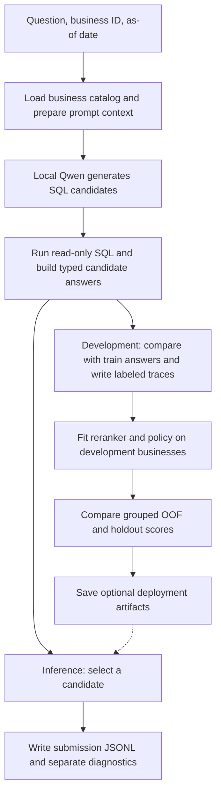

# Baseline runtime and training workflow

This page describes the checked-in text-to-SQL baseline. The team can run it as a reference while evaluating other approaches. The [harness design](02-harness.md) and [methods notes](03-methods.md) cover proposed extensions.



## 1. What happens to one question

1. **Load the right business.** The question supplies `id`, `business_id`, `question`, and `as_of_date`. The [catalog](../src/datamate/data/catalog.py) loads CSV, Excel, and SQLite data from `data/<business_id>/` into in-memory tables, normalizes identifiers, and registers the tables with DataFusion. Catalogs are reused within a run.
2. **Prepare the prompt.** The [candidate pipeline](../src/datamate/application/candidates.py) takes a bounded schema with sample values, relevant calendar context, the split rulebook, and the business README when present. The catalog orders schema entries by token overlap with the question. The prompt gives Qwen `as_of_date` so it can resolve expressions such as “last month.”
3. **Generate candidates.** The [GGUF adapter](../src/datamate/generation/local_gguf.py) asks Qwen for JSON with `sql` and `type`. The default budget allows up to three sequential attempts with different instructions. The pipeline skips duplicate SQL and responses with neither SQL nor `type=unanswerable`, so the saved candidate count can be lower than the attempt count.
4. **Execute and build answers.** The [executor](../src/datamate/execution/sql.py) accepts one read-only `SELECT` or CTE per candidate. The [answer adapter](../src/datamate/application/answers.py) converts the SQL result to the requested answer type. A candidate can fail during SQL execution or answer conversion. A generated `unanswerable` candidate takes a separate path that needs no SQL.
5. **Extract candidate features.** The [feature extractor](../src/datamate/ranking/features.py) records signals such as SQL validity, result shape, joins, date filters, and agreement between candidates. The same feature code is used when collecting train examples and when answering new questions.

## 2. Collect examples, then fit the models

**Collection** uses the existing Qwen weights to generate examples for a separate model. The [collector](../scripts/collect_candidates.py) reads `train/questions.jsonl`, runs the shared pipeline, and compares candidate answers with `train/answers.jsonl` using the [local evaluator](../src/datamate/evaluation/labels.py). It writes one JSONL record per question, including questions with zero retained candidates.

| Field | What it records |
| --- | --- |
| `id`, `business_id`, `question`, `reference` | The question and its reference answer. The reference is used for labeling and scoring. |
| `candidates[].sql`, `type`, `answer`, `result` | The generated SQL, typed candidate answer, execution details, and any SQL error. |
| `candidates[].features` | The signals available to the reranker at inference time. |
| `candidates[].label` | `1` if the answer matches the reference, `0` otherwise. An unusable candidate also receives `0`. |
| `candidates[].reward` | `+1` for a match, `-1` for an incorrect prediction, and `0` when there is no usable answer. |
| `generation_elapsed_ms` | Time per question, including any first catalog load, prompt preparation, model calls, SQL execution, and labeling. `candidates[].result.elapsed_ms` measures the SQL execution separately. |

For example, suppose the reference says five cups of peach tea were sold. A candidate that sums the quantity for peach tea and returns `5` gets label `1`. A candidate that counts two order lines instead gets label `0`, even if its SQL executes successfully. This is the difference the reranker tries to learn from candidate features.

**Fitting and evaluation** start when the [experiment script](../scripts/evaluate_experiment.py) reads the saved traces. The script fits a logistic-regression reranker on candidate features and correctness labels. If the fit examples contain fewer than two label classes, the reranker falls back to heuristic scores. The optional policy fits regressors on candidate traces to estimate the value of submitting or requesting another candidate, with abstention valued at zero.

The [seed-2026 manifest](../configs/splits/seed_2026.json) keeps all questions from one business in the same group. Collecting all 3,000 questions supplies traces for both development and holdout. Four grouped out-of-fold (OOF) runs compare strategies within the 24 development businesses. The final fit uses those 24 businesses, and the script scores the six holdout businesses separately. The script uses the holdout comparison as a check when enabling artifacts. Keep public test results out of fitting and configuration selection.

The metrics report compares the first retained candidate, heuristic selection from the larger pool, reranking, and policy replay. The report calls the first strategy `greedy_n1`, although the first retained candidate can come from a later generation attempt. The primary score is Penalized Accuracy (PA), calculated as `(correct − wrong) / total questions`. The report also includes `oracle_at_3`, the fraction of questions with at least one correct candidate in the saved pool. Use this alongside the selected-answer results to distinguish missing correct candidates from selection errors. The evaluator writes `artifacts/reranker.joblib` and `artifacts/policy.joblib`. A file contains `None` when its component does not meet the script's enablement criteria.

## 3. Run and monitor the experiment

From the repository root, with the training kit and GGUF weights in place, run these PowerShell commands. The output directory keeps each run's traces and metrics separate.

```powershell
uv sync --locked
$run = "artifacts/full_train_$(Get-Date -Format yyyyMMdd_HHmmss)"
uv run python scripts/collect_candidates.py --candidates 3 --output "$run/train_candidates.jsonl"
```

For a quick check, pass `--limit 10 --candidates 1` and use a separate output path. `--limit` takes the first rows in file order. Use the complete trace set for the grouped experiment. After the collector exits successfully and the trace contains 3,000 question records, run the second command in the same PowerShell session.

```powershell
uv run python scripts/evaluate_experiment.py `
    --candidates "$run/train_candidates.jsonl" `
    --manifest configs/splits/seed_2026.json `
    --output "$run/experiment_metrics.json"
```

The metrics path is per run. The evaluator still writes both `.joblib` files at the root of `artifacts/` and can replace files from an earlier experiment. The collector and evaluator are separate commands. A launcher can run them in sequence after validating that collection completed.

To check progress from another PowerShell terminal, set `$run` to the active run directory and count the completed records.

```powershell
$run = 'artifacts/full_train_YYYYMMDD_HHMMSS'
(Get-Content -LiteralPath "$run/train_candidates.jsonl" | Measure-Object -Line).Lines
```

The collector flushes each completed question to disk and prints progress every 25 questions. With three attempts, the full run can make up to 9,000 sequential Qwen calls. The default runtime uses the CPU and disables prompt-prefix caching, so the shared prompt context is processed again on each attempt. Compare `generation_elapsed_ms` with the saved SQL timings to see where time is going. The trace does not report separate prompt-processing and token-generation times.

If a local launcher writes `status.txt`, `collecting` means it is generating and labeling candidates, and `fitting_and_evaluating` means it has moved on to the experiment script. The standalone collector does not create a status file.

To stop collection, interrupt the terminal running the collector. Complete records remain available for inspection. Check the last line for valid JSON before reusing a stopped trace. The collector opens its output in write mode and has no resume support. Use a fresh output path when restarting to preserve the earlier trace. An interrupted run can be used for debugging, while its coverage across the fixed groups must be checked before interpreting evaluation metrics.

## 4. Produce an inference submission

The argument-free [predict.sh](../predict.sh) runs `python -m datamate` inside the evaluator. It reads `/data/questions.jsonl` and the business packages under `/data/data/`, and writes typed answers to `/result/submission.jsonl`. Diagnostics go under `/result/logs/`. Inference uses the question and business data without reference answers. The runner accepts optional reranker and policy artifacts through `DATAMATE_RERANKER_PATH` and `DATAMATE_POLICY_PATH`.

The agent returns the first candidate with a usable answer in the selected order. The order is generation order when no reranker is loaded. The agent returns `abstain` if no candidate provides a usable answer or if processing raises an exception. The current inference policy callback controls whether to keep generating. Its `abstain` action can stop generation, but final answer selection still takes the first usable candidate. Offline policy replay handles `abstain` explicitly, so its score does not establish equivalent end-to-end inference behavior.

See [package architecture](05-package-architecture.md) for ownership by module and the [workplan](04-workplan.md) for checks before freezing a submission.
