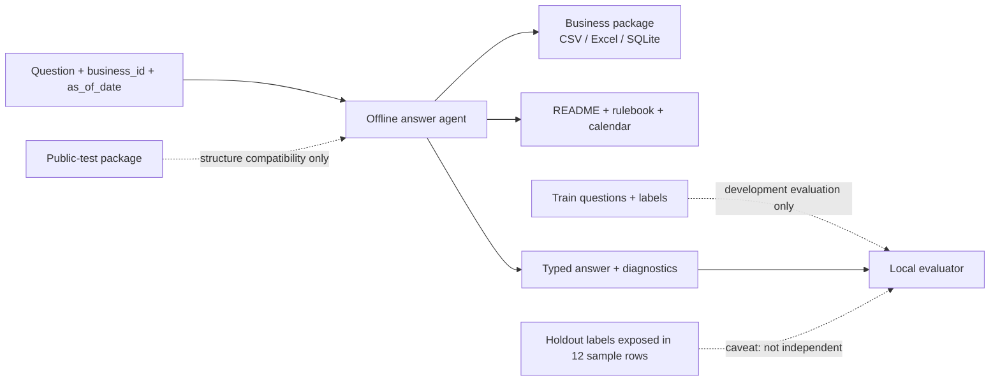
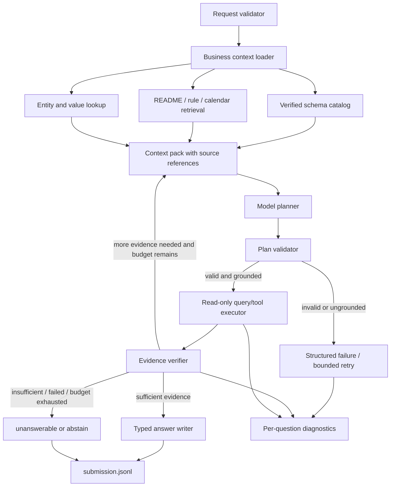
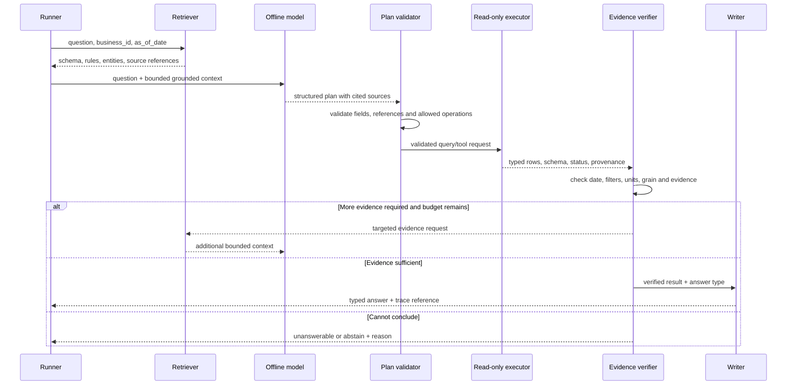
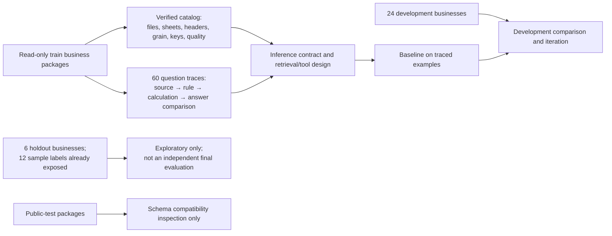

# Proposed agentic RAG architecture

**Status: proposal.** The source solver was removed. This document records the target flow for discussion and implementation planning; it does not claim that these components or interfaces exist yet. The team will confirm retrieval units, plan format, tools and model after validating the 30 training-business catalogs and tracing the 60 representative questions.

## System context

## Component and evidence flow

The executor handles one business context at a time. The validator restricts operations to the approved read-only interface and verifies referenced tables/columns against the retrieved catalog. The verifier checks evidence and result shape before answer serialization. Retrieval and tool retries are bounded; errors, empty results and valid zero values remain distinct.

## Per-question sequence

## Data preparation and evaluation boundary

Development/holdout assignment follows `configs/splits/seed_2026.json`. The representative sample contains 48 development and 12 holdout questions. The team may trace all 60 as agreed, while reporting the holdout exposure caveat and avoiding claims of independent evaluation on those examples.

## Decisions deferred until data tracing

- Lexical, schema-aware or dense retrieval and whether an index is needed.
- Structured JSON plan versus constrained SQL, or a measured combination.
- Exact tool schemas, error statuses, retry/budget limits and evidence thresholds.
- Model and runtime selection under offline, parameter, latency and memory limits.
- Package boundaries and final code-level dependency graph.
