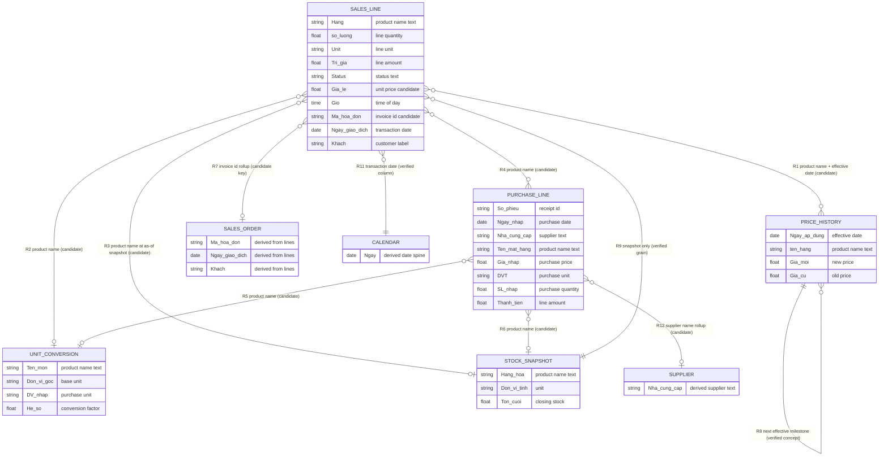

# `biz_105` ERD and join contract

**Status: design artifact (proposal).** This document defines the logical entities,
relationships and open measurements for `biz_105`. It is derived from the checked-in
catalog summary and schema map, not from a fresh scan of the business package.

## Evidence status

| Evidence | State in this checkout | Use here |
|---|---|---|
| `docs/data-schema-catalog.md` §`biz_105` | present | primary verified inventory: files, sheets, headers, columns, row counts, date ranges, grain |
| `docs/business-schema-map.md` §A5 | present | archetype roles, missing sources, parser traps |
| `docs/plan/02-tracing-issues.md` Issue 5 | present | confirmed absence of employee-feedback source for `biz_105` |
| `docs/question-answer-taxonomy.md` | present | answer types, time semantics, unanswerable reasons |
| `scripts/build_data_catalog.py` | present | intended catalog/join-metric format |
| `artifacts/data_prep/data_catalog.json` | **absent** | measured key uniqueness, nulls, cardinality and join coverage are unavailable |
| `artifacts/data_prep/source_quality.csv` | **absent** | per-column quality metrics are unavailable |
| `train/data/biz_105/` | **absent** | no source rows can be re-measured in this checkout |

Consequences:

- **Verified** below means documented structural/grain facts from the verified catalog.
- **Candidate** means a plausible relationship whose key uniqueness, null behaviour,
  cardinality or referential coverage has **not** been measured in this checkout.
- No value in this document is a gold answer, and no statistic here was computed from
  `train/answers.jsonl`.

## 1. Physical inventory

`biz_105` has **6 physical files** and **21 tables**: 17 monthly sales sheets plus four
single-sheet workbooks. The sales header is on **row 2** in every sheet. The documented
data cutoff is **2026-06-24**.

| File | Table / sheet | Data rows | Header row | Grain (catalog status) |
|---|---|---:|---:|---|
| `BangGia.xlsx` | `Sheet1` | 78 | 1 | one price milestone per product; valid until the next change (verified) |
| `DanhMuc.xlsx` | `Sheet1` | 2 | 1 | one conversion factor per product/unit pair (verified) |
| `SoBanHang_1.xlsx` | `Thang 02 2025` | 6,490 | 2 | one sales line (verified) |
| `SoBanHang_1.xlsx` | `Thang 03 2025` | 8,139 | 2 | one sales line (verified) |
| `SoBanHang_1.xlsx` | `Thang 04 2025` | 7,763 | 2 | one sales line (verified) |
| `SoBanHang_1.xlsx` | `Thang 05 2025` | 8,072 | 2 | one sales line (verified) |
| `SoBanHang_1.xlsx` | `Thang 06 2025` | 8,040 | 2 | one sales line (verified) |
| `SoBanHang_1.xlsx` | `Thang 07 2025` | 8,307 | 2 | one sales line (verified) |
| `SoBanHang_1.xlsx` | `Thang 08 2025` | 8,702 | 2 | one sales line (verified) |
| `SoBanHang_1.xlsx` | `Thang 09 2025` | 8,208 | 2 | one sales line (verified) |
| `SoBanHang_1.xlsx` | `Thang 10 2025` | 8,853 | 2 | one sales line (verified) |
| `SoBanHang_1.xlsx` | `Thang 11 2025` | 8,443 | 2 | one sales line (verified) |
| `SoBanHang_1.xlsx` | `Thang 12 2025` | 8,828 | 2 | one sales line (verified) |
| `SoBanHang_1.xlsx` | `Thang 01 2026` | 9,059 | 2 | one sales line (verified) |
| `SoBanHang_2026.xlsx` | `Thang 02 2026` | 6,299 | 2 | one sales line (verified) |
| `SoBanHang_2026.xlsx` | `Thang 03 2026` | 9,240 | 2 | one sales line (verified) |
| `SoBanHang_2026.xlsx` | `Thang 04 2026` | 8,947 | 2 | one sales line (verified) |
| `SoBanHang_2026.xlsx` | `Thang 05 2026` | 9,531 | 2 | one sales line (verified) |
| `SoBanHang_2026.xlsx` | `Thang 06 2026` | 7,324 | 2 | one sales line (verified); last date 2026-06-24 |
| `SoNhapHang.xlsx` | `Sheet1` | 1,373 | 1 | one purchase line (verified) |
| `TonKho.xlsx` | `Sheet1` | 50 | 1 | stock snapshot at the README data date; not stock history (verified) |

Sales total: **140,245 data rows across 17 sheets**. The catalog's per-sheet
duplicate-excess counts sum to **2,222** (between 100 and 157 per sheet). They are
**not** removed automatically; rulebook §8 handling is required and is a verifier
condition for line-grain answers.

Not present in `biz_105`: product master with IDs, customer master, supplier master,
delivery table (`SoGiaoHang`), debt-due table (`SoHanNo`), employee table, or
feedback/survey table. These absences are design facts, not failures to load.

### Column roles

| Logical entity | Actual columns | Role notes |
|---|---|---|
| `SALES_LINE` | `Hàng`, `so_luong`, `Unit`, `Trị giá`, `Status`, `Giá lẻ`, `Giờ`, `Mã hóa đơn`, `Ngày giao dịch`, `Khách` | product name is the only product key; `Trị giá` is a line amount; `Giá lẻ` is a unit price candidate; `Mã hóa đơn` is an order header candidate; `Khách` is a free-text customer label |
| `PRICE_HISTORY` | `Ngày áp dụng`, `ten_hang`, `Giá mới`, `Giá cũ` | temporal price milestones; `ten_hang` is free text |
| `UNIT_CONVERSION` | `Tên món`, `Đơn vị gốc`, `ĐV nhập`, `Hệ số` | only 2 rows; conversion coverage is necessarily sparse |
| `PURCHASE_LINE` | `Số phiếu`, `Ngày nhập`, `Ghi chu`, `Thành tiền`, `Nhà cung cấp`, `Tên mặt hàng`, `Giá nhập`, `ĐVT`, `SL nhập` | `Số phiếu` is a receipt candidate; `Thành tiền` may repeat at receipt level |
| `STOCK_SNAPSHOT` | `Hàng hóa`, `Đơn vị tính`, `Tồn cuối` | one snapshot only; no date column |
| `CALENDAR` (derived) | none | generated from `as_of_date` and the measured date range |

## 2. Logical ERD

`SALES_ORDER` is not a physical table. Order-level attributes repeat on every
`SALES_LINE`, so order metrics require grouping `Mã hóa đơn` after line-grain filters.
The 17 monthly relations are vertical partitions of one logical `SALES_LINE` entity.



## 3. Relationship register

Fan-out is the main correctness risk: every product link is name-based, and only
`PRICE_HISTORY` has documented temporal keys.

| ID | Left → right | Join columns | Status | Key / nulls | Expected cardinality | Coverage | Fan-out / temporal rule |
|---|---|---|---|---|---|---|---|
| R1 | `SALES_LINE` → `PRICE_HISTORY` | normalised `Hàng` = normalised `ten_hang`, then `Ngày áp dụng <= Ngày giao dịch` | **candidate** | no declared key; uniqueness of (`ten_hang`, `Ngày áp dụng`) unmeasured; date nulls not measured | many sales lines : many price rows per product | 78 price rows vs unknown distinct sales products | **high**: direct name join multiplies lines. Range/lateral join must pick the latest `Ngày áp dụng` on or before the sale date; price-history gaps and duplicate dates are unresolved |
| R2 | `SALES_LINE` → `UNIT_CONVERSION` | normalised `Hàng` = normalised `Tên món` | **candidate** | `Tên món` uniqueness plausible but unmeasured; only 2 rows | many lines : at most one factor per product (expected) | very low by row count | low if unique; missing products need an explicit base-unit rule, not an assumed factor of 1 |
| R3 | `SALES_LINE` → `STOCK_SNAPSHOT` | normalised `Hàng` = normalised `Hàng hóa` | **candidate** | one row per product expected, unmeasured; duplicate `Hàng hóa` not measured | many sales lines : one snapshot row per product | 50 snapshot rows vs unknown distinct products | low if unique. Snapshot is **as-of only**; it cannot answer historical stock and must not be joined without the README snapshot date |
| R4 | `SALES_LINE` → `PURCHASE_LINE` | normalised `Hàng` = normalised `Tên mặt hàng` | **candidate** | no key; product-name text only; supplier text only | many : many | 1,373 purchase lines vs unknown product overlap | **high**: do not aggregate sales and purchases in one row set; use purchase data only for purchase questions or measured coverage checks |
| R5 | `PURCHASE_LINE` → `UNIT_CONVERSION` | normalised `Tên mặt hàng` = normalised `Tên món` | **candidate** | as R2 | many : at most one | very low | low if unique; unit mismatch between `ĐVT` and `Đơn vị gốc` unresolved |
| R6 | `PURCHASE_LINE` → `STOCK_SNAPSHOT` | normalised `Tên mặt hàng` = normalised `Hàng hóa` | **candidate** | as R3 | many : one | unknown | low if unique; snapshot quantity cannot be reconciled with purchases without full inventory history |
| R7 | `SALES_LINE` → `SALES_ORDER` (derived) | `Mã hóa đơn` | **verified column; candidate key** | invoice id exists; uniqueness per sheet and across 17 sheets unmeasured; blank ids possible per rulebook §8 | many lines : one order (expected) | all sales sheets | grouping is required before order-count/AOV; cross-sheet id collisions could merge unrelated orders |
| R8 | `PRICE_HISTORY` self | `ten_hang`, next `Ngày áp dụng` | **verified concept** | same-product same-date duplicates unmeasured | one milestone : next milestone | 78 rows | interval validity is `[Ngày áp dụng, next date)`; the final row is open-ended |
| R9 | `STOCK_SNAPSHOT` → `SALES_LINE` | product name | **verified grain** | snapshot date not in the table; README owns it | one snapshot per product : many sales lines | 50 rows | no temporal history; never sum the snapshot over dates |
| R10 | 17 `SALES_LINE` sheets → one logical relation | vertical union | **verified structural** | same 10 columns and header row 2; duplicate-excess rows per sheet | vertical partition, not a join | 140,245 rows | apply rulebook §8 per sheet before cross-sheet aggregation; do not deduplicate blindly across sheets |
| R11 | `SALES_LINE` → `CALENDAR` | `Ngày giao dịch` | **verified column** | invalid dates reported 0 by catalog | many lines : one date | 2025-02-01 → 2026-06-24 | include rows on `as_of_date` only when the rulebook says so; relative periods resolve from `as_of_date`, not wall clock |
| R12 | `PURCHASE_LINE` → `SUPPLIER` (derived) | `Nhà cung cấp` | **candidate** | free text; no supplier id; normalisation unmeasured | many lines : one supplier label | 1,373 lines | group only after measured normalisation; spelling variants can split one supplier |

### Why R1 is not a normal foreign key

`BangGia` records price **milestones**, so a product can have several valid-looking rows.
A direct `JOIN ... ON name` fans out each sales line once per milestone. The executor
must implement an as-of join: choose the greatest `Ngày áp dụng` that is `<=` the sale
date, or report `insufficient_evidence` when no milestone covers the sale date.

`so_luong`, `Unit`, `Giá lẻ` and `Trị giá` describe the same line at different levels.
Do not multiply `so_luong × Giá lẻ` to replace `Trị giá` unless the rulebook confirms
that `Trị giá` excludes discounts or adjustments.

## 4. Key uniqueness and null status

No primary key is **verified** for any `biz_105` table. The following are candidates to
measure, not claims:

| Entity | Candidate key | Uniqueness | Null / duplicate risk |
|---|---|---|---|
| `SALES_LINE` | (`sheet`, `Mã hóa đơn`, `Hàng`, `Giờ`, `so_luong`, `Trị giá`) | unmeasured | 2,222 raw duplicate-excess rows; blank group cells may need forward-fill per rulebook §8; `Khách` may be blank/cash customer; `Mã hóa đơn` may be blank |
| `SALES_ORDER` (derived) | `Mã hóa đơn` per sheet or globally | unmeasured | cross-sheet id reuse unknown; blank ids cannot form an order |
| `PRICE_HISTORY` | (`ten_hang`, `Ngày áp dụng`) | unmeasured | duplicate same-day milestones and missing intervals unknown |
| `UNIT_CONVERSION` | `Tên món` or (`Tên món`, `Đơn vị gốc`, `ĐV nhập`) | unmeasured; only 2 rows | product not covered is expected |
| `PURCHASE_LINE` | (`Số phiếu`, `Tên mặt hàng`, `ĐVT`, `Giá nhập`) | unmeasured | repeated receipt totals in `Thành tiền` must not be summed per line; duplicate lines unknown |
| `STOCK_SNAPSHOT` | `Hàng hóa` (+ `Đơn vị tính`) | unmeasured; 50 rows | duplicate product/unit combinations and blank units unknown |

## 5. Referential coverage and many-to-many risks

Measured coverage is **not available** in this checkout. Expected risks:

1. **Product-name M:N.** Sales, price, purchase, stock and conversion tables share only
   free-text product names. Diacritics, telex spellings, case, whitespace and unit
   suffixes can all split or merge products.
2. **Price fan-out.** Multiple milestones per product; naive joins inflate revenue or
   price-effect calculations. Use an as-of join and verify one price row per line.
3. **Stock is a snapshot.** `TonKho` has one closing quantity per product, not a
   history. It can answer "current stock at the README snapshot date" and cannot answer
   "stock on 2025-08-01" or stock movement.
4. **Sparse conversion table.** `DanhMuc` has 2 rows. A missing product is not evidence
   that its factor is 1 unless the business rulebook says so.
5. **Purchase-line totals.** `Thành tiền` may describe a receipt-level amount repeated
   on lines. Sum distinct receipts or sum line amounts only after grain verification.
6. **Order-id collisions.** If `Mã hóa đơn` restarts per month, a global `GROUP BY`
   merges different orders. Measure per-sheet and global uniqueness before order metrics.
7. **Status semantics.** `Status` has no documented value dictionary in the catalog.
   Returns, cancellations and zero-value lines must be classified from the rulebook and
   measured value counts, not guessed from the column name.
8. **Customer labels.** `Khách` is free text with no customer id. Repeat-customer and
   top-customer questions need a measured identity rule; otherwise they are ambiguous.

## 6. Temporal join contract

### Price as-of join (R1)

```sql
-- Illustrative only. Relation names, normalisation functions and the line key are
-- owned by the runtime. The final predicate must produce one price row per sale line.
WITH priced AS (
    SELECT
        s.*,
        p."Giá mới",
        ROW_NUMBER() OVER (
            PARTITION BY s."Mã hóa đơn", s."Hàng", s."Giờ", s."Ngày giao dịch", s."Trị giá"
            ORDER BY p."Ngày áp dụng" DESC
        ) AS price_rank
    FROM sales AS s
    LEFT JOIN price_history AS p
      ON normalise(s."Hàng") = normalise(p."ten_hang")
     AND p."Ngày áp dụng" <= s."Ngày giao dịch"
)
SELECT * FROM priced WHERE price_rank = 1;
```

Verifier requirements:

- `price_rank = 1` for every line used in a price-effect answer;
- no price row when the lookup date precedes the first milestone → do not substitute zero;
- duplicate milestones on one date → ambiguity unless the rulebook resolves them;
- `Giá mới` and `Giá cũ` are not interchangeable with `Giá lẻ`.

### Stock snapshot (R3/R9)

Filter the single snapshot once, at the README snapshot date. A query that joins it to a
sales date range without an explicit "current snapshot" assumption must fail
verification. Historical stock is out of scope and should be `unanswerable` when the
question requires it.

### Sales period (R11/R10)

- Union the 17 sheets as one logical relation; never join them to each other.
- Apply `as_of_date` to `Ngày giao dịch`; for "this month", stop at `as_of_date`.
- A period partly covered by data is computed on the covered part (taxonomy §7).
- A period wholly outside `[2025-02-01, 2026-06-24]` is `unanswerable`
  (`period_out_of_coverage`), not zero.
- Missing dates inside the range are not automatically zero; they may be non-selling
  days or missing data, so the verifier must distinguish them.

## 7. Measurement checklist (not run here)

These checks must run against `train/data/biz_105/` with the verified loaders before any
candidate relationship becomes verified. Suggested outputs feed
`artifacts/data_prep/data_catalog.json` and `source_quality.csv`.

1. Row counts per sheet match the catalog totals (140,245 sales rows).
2. Exact duplicate-excess counts per sheet match the catalog (2,222 total) and the
   rulebook §8 handling is documented.
3. Null/blank counts for all 10 sales columns, especially `Mã hóa đơn`, `Khách`,
   `Status`, `Giờ` and `Ngày giao dịch`.
4. `Mã hóa đơn` uniqueness per sheet, globally, and after excluding blanks.
5. Distinct normalised product names in sales, price, purchase, stock, conversion;
   pairwise overlap counts and top unmatched names.
6. Duplicate (`ten_hang`, `Ngày áp dụng`) milestones and interval gaps/overlaps.
7. Duplicate `Tên món`/unit rows in `DanhMuc`; unit values in sales vs conversion.
8. Duplicate `Hàng hóa`/unit rows in `TonKho`; exact snapshot date from README.
9. Duplicate purchase lines and whether `Thành tiền` repeats by `Số phiếu`.
10. Distinct `Status` values and their row/amount distribution.
11. Non-positive `so_luong`, `Trị giá`, `Giá lẻ` and `Tồn cuối`; return/cancellation
    patterns.
12. Date coverage per sheet, invalid dates, and rows dated after the documented cutoff.

Until these are measured, Member 4 must keep candidate joins behind the verifier and
Member 5 must not score candidate-join answers as structurally verified.

## 8. Unresolved questions

- Is `Mã hóa đơn` unique per sheet, globally, or reused across months?
- Does `Trị giá` include discounts, returns or service fees?
- Which `Status` values mean completed, cancelled or returned?
- Is `Giờ` reliable, and how does `as_of_date` interact with same-day rows?
- Are product names stable across sales, price, purchase and stock, or are aliases common?
- Does `DanhMuc` cover only two products, and what is the fallback conversion rule?
- Are there duplicate price milestones on the same effective date?
- What exact snapshot date does the `biz_105` README assign to `TonKho`?
- Can `TonKho` be reconciled with purchases and sales, or is it only a standalone snapshot?
- Does `Thành tiền` repeat at receipt level in `SoNhapHang`?
- Are customer labels (`Khách`) reusable identities or free text?
- How should the 2,222 duplicate-excess sales rows be treated for revenue, line counts
  and product rankings under rulebook §8?

These remain **open** until Member 1's catalog/quality artifacts and the source package
are available. The ERD must not be cited as measured referential integrity before then.
