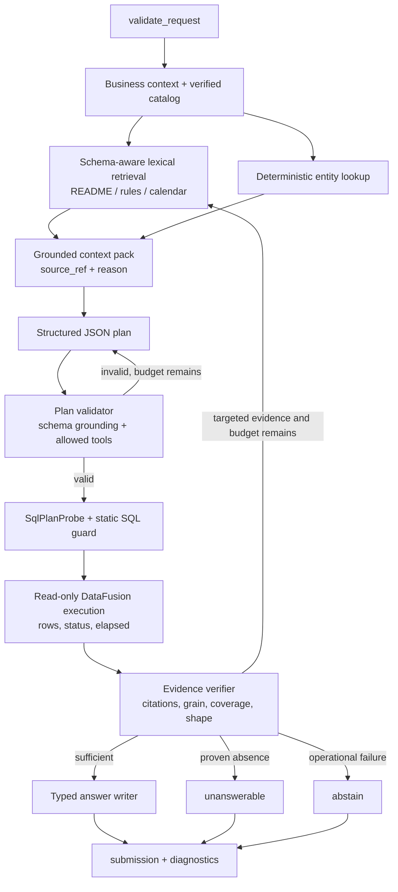

# Inference contract v0 and agentic RAG policy

**Status: proposal for lead review.** Contract version **0.1.0**. The budgets in this
document are **candidates**, not approved production limits. No model was selected,
downloaded or run, and no end-to-end inference result is claimed.

This is Member 3's design deliverable. It defines the request, retrieval, plan, tool,
verification, answer and diagnostic boundaries for the rebuilt DataMate agent. It does
not implement Member 4's runtime or Member 5's evaluator.

## 1. Scope and non-claims

In scope:

- per-question inference contract and machine-readable schema;
- retrieval policy and provenance;
- structured plan and read-only SQL boundary;
- reusable SQL/plan guardrails and bounded budgets;
- typed-answer, unanswerable and abstain policy;
- one measured-grain ERD for `biz_105`;
- contract and guardrail tests.

Not in scope / not claimed:

- a trained model, prompt template, local GGUF runtime or `predict.sh` implementation;
- execution against real business rows (the source packages are absent in this checkout);
- independent holdout performance, or any score from `train/answers.jsonl`;
- approval of the candidate token, retry, row or timeout limits;
- measured `biz_105` key uniqueness, nulls, cardinality, join coverage or fan-out;
- full-project test success (other phase modules are still missing).

## 2. Evidence examined

| Evidence | State | How it was used |
|---|---|---|
| `docs/architecture/agentic-rag.md` | present | 12-stage target flow and deferred decisions |
| `docs/02-harness.md` | present | stage records and failure-state requirements |
| `docs/plan/03-agentic-rag-inference.md` | present | I01–I07 tasks and Gate inference review |
| `docs/data-schema-catalog.md` | present | verified `biz_105` inventory, grains, row counts, date ranges |
| `docs/business-schema-map.md` | present | archetype A5 roles and missing sources |
| `docs/plan/02-tracing-summary.md` / `02-tracing-issues.md` | present | 60-trace patterns, blockers, E8/FIFO/header/debt traps |
| `docs/question-answer-taxonomy.md` | present | 8 answer types, time semantics, unanswerable causes |
| `configs/representative_questions.json` | present | design distribution only; never used as runtime input |
| `configs/splits/seed_2026.json` | present | business-level development/holdout split |
| `artifacts/data_prep/question_trace.jsonl` | **absent** | full 60-trace records were not inspected |
| `artifacts/data_prep/data_catalog.json` | **absent** | measured join metrics were not available |
| `artifacts/data_prep/source_quality.csv` | **absent** | column quality metrics were not available |
| `train/data/biz_105/` | **absent** | no source rows could be measured |
| `src/datamate/*` (runtime) | only a scaffold | no existing runtime to integrate with |

The checked-in `docs/data-schema-catalog.md` is a secondary summary of Member 1's
catalog, not the measured artifact itself. Statements about `biz_105` in this contract
are limited to what that summary documents.

## 3. Decisions

### D1 — Retrieval: schema-aware lexical + deterministic entity lookup

v0 does **not** use a dense vector index. Per-business schemas are small, Member 1's
verified catalog is the source of truth, and there is no established embedding corpus,
embedding budget or offline embedding runtime. Retrieval units are:

1. the business README and rulebook sections selected by intent keywords;
2. verified table/column/grain/key metadata;
3. calendar and `as_of_date` rules;
4. aliases and distinct entity values (products, customers, suppliers);
5. bounded samples used only to inspect format/value spelling;
6. prior tool results and their provenance.

Every section carries a `source_ref` and a retrieval reason. Gold answers, answer
references, public-test labels and evaluation scores are excluded by contract and
checked by `validate_no_reference_leakage`.

### D2 — Representation: structured plan + one terminal SQL step

The model returns a JSON plan with intent, time window, entity bindings, filters, answer
type, expected shape, cited sources, assumptions, unknowns and an ordered tool plan. The
last data tool is one constrained `run_sql` call. This keeps language understanding
(date phrases, aliases, intent) separate from deterministic operations (calendar
resolution, filters, aggregation, typing).

A free-form SQL-only plan was rejected for v0 because it hides intent/answer-type
decisions and makes abstain/evidence policy harder to audit. A no-SQL plan was rejected
because most questions require measured aggregation. The comparison in I04 remains open
until a model exists.

### D3 — Tool boundary: four tools, no general execution

| Tool | Purpose | Hard limit |
|---|---|---|
| `get_schema` | verified table/column metadata | current business only; max 21 tables |
| `search_entities` | alias/distinct-value lookup and ambiguity detection | max 50 matches |
| `sample_rows` | bounded format/value inspection | max 5 rows, deterministic order |
| `run_sql` | plan and execute one read-only `SELECT` | 1 statement, 200 rows, 15 s |

The agent cannot execute arbitrary Python, shell, network or filesystem operations.
There is no `read_csv`, `read_parquet`, `COPY`, `ATTACH`, extension install or
schema-qualified system-table access. SQL is planned by DataFusion and executed only
through the read-only executor.

### D4 — Answer type is independent of execution status

`answer.type` is one of `number`, `percent`, `date`, `boolean`, `string`, `list`,
`table`, `unanswerable`. `execution_status` is one of `answered`, `unanswerable`,
`abstain`. `reason_code` explains why. An operational failure is never encoded by
inventing an answer type or a zero.

### D5 — Outcome policy

- Proven absence of a source role, a period wholly outside measured coverage, or a
  subjective fact the data cannot record → `unanswerable`.
- Execution error, timeout, budget exhaustion, missing runtime source, blocked catalog,
  ambiguity, invalid model output, schema mismatch or failed verification → `abstain`.
- An empty result is not numeric zero. A single-row zero count is a valid zero. A null
  aggregate is insufficient evidence.
- A period partly inside coverage is computed on the covered part (taxonomy §7).
- Abstain is serialized to the competition format as `type: "unanswerable"`; the
  distinction remains in diagnostics and is never lost in logs.

### D6 — SQL guardrails: tokenizer + logical plan, not regex

Static validation uses a real lexer that understands strings, quoted identifiers and
comments, plus statement/table/function/allow-list checks. Final validation uses
DataFusion 55.0.0's logical planner against empty typed tables built from the verified
schema. See §8.

### D7 — Budgets are candidates

Input 1,500 tokens, 6 tool calls, 2 retrieval rounds, 3 SQL attempts (initial + two
corrections), 200 result rows, 5 sample rows, 15 s query timeout, 30 s question timeout.
All are configurable and marked `"status": "candidate"` in the contract.

## 4. Per-question flow



The flow matches the mentor pipeline: request → context → retrieval → plan → validation
→ execution → verification → writer → submission, with bounded repair loops and distinct
failure states.

## 5. Contract schema map

`configs/inference_contract.json` is one JSON Schema (draft 2020-12) whose root validates
the **internal per-question result**. Reusable schemas live in `$defs` and are exposed
through `x-schemas`.

| Section | Purpose | Key required fields |
|---|---|---|
| `request` | evaluator input | `id`, `business_id`, `question`, `as_of_date` |
| `business_context` | verified package view | `catalog_status`, `tables`, `sources`, grain per table |
| `retrieval_context` | grounded prompt sections | `sources`, `sections[].source_ref`, `sections[].why`, `token_estimate` |
| `plan` | model decision record | `intent`, `time`, `entities`, `answer_type`, `expected_shape`, `sources`, `steps` |
| `tool_call` | one bounded call | `call_id`, `tool`, `status`, `elapsed_ms`, `sql_validation` |
| `sql_validation` | guardrail result | `ok`, `tables`, `plan_checked`, `columns_checked` |
| `verification` | pre-write checks | `passed`, `checks`, `date_coverage`, `dedup_applied`, `plan_checked`, `reason_code` |
| `answer` | competition typed answer | `type`, `answer` |
| root result | audit record | version, question, status, reason, answer, plan, evidence, calls, verification, budgets, errors, diagnostics |
| `submission` | evaluator-facing record | `id`, `type`, `answer`; optional `alias` |
| `diagnostics` | log record | status, reason, answer type, calls, verification, errors |
| `error` | structured failure | `code`, `message`, `stage`, `retryable`, `detail` |

The contract also carries `x-retrieval-policy`, `x-budgets`, `x-tool-contracts`,
`x-outcome-mapping`, `x-open-decisions` and 22 synthetic examples. Examples contain
**no real answers**; they use `q_synthetic...` IDs and placeholder values.

### Answer types

| Type | JSON shape | Guardrail |
|---|---|---|
| `number` | finite JSON number | booleans, strings, NaN/inf rejected |
| `percent` | number = percent points, rounded to 2 decimals | no `%` sign; caller converts 0.124 → 12.4 |
| `date` | `YYYY-MM-DD` or `YYYY-MM` | calendar-valid ISO; no `dd/mm/yyyy` |
| `boolean` | `true` / `false` | strings and 0/1 rejected |
| `string` | non-empty string | original data spelling preserved |
| `list` | non-empty ordered array | order preserved; empty list rejected |
| `table` | `{columns, rows}` | unique columns, rectangular, scalar cells |
| `unanswerable` | `null` answer | any value rejected |

`alias` remains optional and is only emitted by the submission builder. Whether the
evaluator accepts alias on every type still needs Member 5 confirmation; the schema does
not force it.

## 6. Retrieval policy

- **No dense index in v0.** Lexical matching runs over verified metadata, README/rule
  sections and entity values. A dense index would need a measured corpus, an offline
  embedding runtime and a quality comparison first.
- **Provenance is mandatory.** A plan source must cite a retrieved `source_ref`; the
  verifier fails ungrounded citations.
- **Question normalisation.** Casefold, strip Vietnamese diacritics for matching,
  collapse punctuation/whitespace, but keep the original value for string/list answers.
- **Two rounds maximum.** Round 1 is the initial context pack. Round 2 is a targeted
  request caused by a named missing item (column, rule, entity value, date boundary).
  A round without a named gap is not allowed.
- **Token budget.** `check_context_budget` estimates three characters/token
  conservatively. The 1,500-token limit is a candidate; it must be rechecked with the
  chosen model tokenizer and development comparisons.
- **Samples are bounded and deterministic.** `sample_rows` returns at most 5 rows and is
  for format/spelling inspection, not for computing answers.
- **No label leakage.** Reference answers, labels and evaluation scores are blocked by
  key inspection before any prompt/evidence payload is accepted. Development labels are
  used only after predictions are written.

## 7. Tools

Full input/output schemas are in `x-tool-contracts`.

1. **`get_schema`** — returns verified table/column/type/grain/source metadata. If the
   verified catalog is unavailable, it returns `catalog_unavailable`; the agent must
   abstain with `blocked_on_catalog`, not reconstruct schema from row samples.
2. **`search_entities`** — deterministic lexical/alias lookup over product, customer and
   supplier values. Returns `resolved`, `ambiguous` or `unmatched` plus scores and
   provenance. Ambiguity is a first-class abstain reason.
3. **`sample_rows`** — at most 5 rows from one verified table, no arbitrary filters.
4. **`run_sql`** — exactly one `SELECT`/`WITH` statement over the current business's
   verified relations. The executor returns typed rows, row count, truncation flag,
   elapsed time, source refs and the guardrail's `sql_validation`.

Tool errors are structured. A failed tool result is never converted into an empty or
zero answer.

## 8. Plan and SQL validation

### Plan validation

- Plan must be valid JSON with the required fields and allowed enum values.
- Every table/column cited in the plan must exist in the verified catalog.
- The plan's `answer_type` must match the answer writer's type.
- Tool steps are limited to the four approved tools; `run_sql` appears at most once as
  the terminal data step in v0.
- A plan that needs a source role absent from the catalog must stop at the planning
  stage with `unsupported_source_role` (unanswerable), not generate speculative SQL.

### Static SQL guard

`guardrails.validate_sql_static` implements a lexer, not regex-only matching:

- strings (`''` escape), quoted identifiers (`""`), backticks and comments (`--`,
  `/* */`) are tokenised so keywords inside them cannot bypass checks;
- exactly one non-empty statement; trailing semicolon allowed;
- the first significant keyword must be `SELECT` or `WITH`;
- DML, DDL and utility keywords (`INSERT`, `UPDATE`, `DELETE`, `DROP`, `CREATE`,
  `ALTER`, `SHOW`, `EXPLAIN`, `SET`, `PRAGMA`, `COPY`, `ATTACH`, transaction keywords,
  `INTO`, etc.) are rejected;
- SQL parameters (`?`, `$1`) are rejected;
- table-valued functions (`read_csv`, `read_parquet`, `generate_series`, `unnest`, …)
  are rejected;
- schema-qualified relations (`information_schema.tables`) are rejected;
- relations in top-level `FROM`/`JOIN` must be in the verified allow-list; CTE names are
  resolved separately;
- quoted column identifiers are grounded against the verified column set (aliases after
  `AS` and table qualifiers are skipped).

### DataFusion logical-plan probe

`guardrails.SqlPlanProbe` builds an empty typed `SessionContext` from the verified
schema, then plans the user SQL with:

```python
SQLOptions().with_allow_ddl(False).with_allow_dml(False).with_allow_statements(False)
```

No rows are collected. The planner resolves tables, columns and functions exactly as the
executor will. The probe recursively walks `.inputs()` and reads `TableScan:` nodes from
`.display()`; every scan must be an allowed, unqualified business table, and at least one
scan is required. This rejects `SHOW`, `information_schema`, `generate_series` and
`SELECT 1`, and classifies unknown tables/columns from planner messages.

Verified with **DataFusion 55.0.0**: DML/DDL and multi-statement rejection, table-function
rejection, logical-plan `TableScan` extraction for joins/CTEs/unions, and unknown
table/column messages.

Known limits, to be covered by tests in the runtime:

- static table extraction only follows top-level `FROM`/`JOIN`; nested subquery relations
  are caught by the probe, so static-only mode is **not** sufficient for production;
- unquoted column grounding relies on the probe;
- quoted aliases without `AS` can be misread as columns (use `AS`);
- normalisation functions (`normalise`, diacritic stripping) must exist in the runtime or
  be materialised as columns; the probe only accepts functions in the DataFusion context;
- project dependency is `datafusion>=43`; 55.0.0 is the tested version and should be
  locked for reproducible guardrail behavior.

## 9. Bounded loop

| Budget | Candidate value | Stop / escalation |
|---|---:|---|
| Input tokens | 1,500 | retrieval stops, contextual sections trimmed; if insufficient → `budget_exhausted` |
| Tool calls | 6 | no further calls; abstain with `budget_exhausted` |
| Retrieval rounds | 2 | no further context requests |
| SQL attempts | 3 (initial + 2 corrections) | third failure → `budget_exhausted` / terminal error |
| Result rows | 200 | `row_limit_exceeded`; the executor must not silently truncate an answer |
| Sample rows | 5 | `row_limit_exceeded` |
| Query timeout | 15 s | `timeout` |
| Question timeout | 30 s | `timeout` |

Every retry must name the failed check (unknown column, parse error, cardinality/fan-out,
missing date boundary) and change the plan/SQL in response. A retry without a new action
is not allowed. Forbidden operations, ambiguous entities and ungrounded citations stop
immediately rather than consuming the retry budget.

## 10. Verification and outcome policy

`verify_evidence` checks:

- answer shape/type validity;
- plan presence and answer-type agreement;
- every plan citation is in the retrieved source set;
- at least one successful tool result and one terminal `run_sql` in v0;
- SQL was logical-plan-checked (unless explicitly allowed static-only, which is a
  residual risk);
- result row count > 0; empty is not zero;
- concrete answer is not null;
- full/partial/none date coverage;
- duplicate-risk handling (required for `biz_105` sales sheets);
- unit conversion checked when the question requires it;
- non-answered outcomes map to the correct status and use `unanswerable`.

Outcome matrix (also machine-readable in `x-outcome-mapping`):

| Reason code | Execution status | Submission type | Meaning |
|---|---|---|---|
| `ok` | `answered` | concrete type | verified evidence |
| `unsupported_source_role` | `unanswerable` | `unanswerable` | source role proven absent |
| `period_out_of_coverage` | `unanswerable` | `unanswerable` | whole period outside data |
| `subjective_information` | `unanswerable` | `unanswerable` | data cannot record it |
| `execution_error` | `abstain` | `unanswerable` | query execution failed |
| `source_missing` | `abstain` | `unanswerable` | runtime source absent |
| `blocked_on_catalog` | `abstain` | `unanswerable` | catalog unavailable/incomplete |
| `budget_exhausted` | `abstain` | `unanswerable` | tool/retry/token budget |
| `insufficient_evidence` | `abstain` | `unanswerable` | empty/null/unverifiable |
| `timeout` | `abstain` | `unanswerable` | deadline exceeded |
| `ambiguous_entity` / `ambiguous_question` | `abstain` | `unanswerable` | unresolved meaning |
| `invalid_model_output` / `schema_mismatch` / `verification_failed` | `abstain` | `unanswerable` | unsafe to answer |
| `invalid_request` | `abstain` | `unanswerable` | request failed validation |

The five traced `biz_105` blockers use `unsupported_source_role` when the source role is
proven absent (as in the employee-feedback case). Operational failures use the distinct
codes above. This is deliberately stricter than collapsing everything into
`insufficient_evidence`.

## 11. Contract validation and tests

Run in a temporary environment with DataFusion 55.0.0 and jsonschema 4.26.0 (jsonschema
is **not** a project dependency; schema tests skip when it is absent):

```powershell
python -m json.tool configs/inference_contract.json > $null
$env:PYTHONPATH = "src"
python tests/test_agent_guardrails.py -v
python tests/test_inference_contract.py -v
python tests/test_biz_105_erd.py -v
```

Results:

- `json.tool`: valid JSON;
- `Draft202012Validator.check_schema`: valid draft 2020-12 schema;
- **22/22** contract examples pass their schema/contract expectation, covering all 8
  answer types, valid answered, unanswerable, parse failure, unknown column, ambiguous
  entity, no evidence, query error, budget exhaustion, blocked catalog and abstain
  submission;
- **120/120** new unit tests pass: 87 guardrail tests, 20 contract tests, 13 ERD tests;
- DataFusion probe tests ran against the installed 55.0.0 environment (not skipped).

Not tested:

- `uv run python -m unittest discover -s tests -v`: **152 tests ran, 4 import errors**
  (`datamate.data`, `datamate.application` ×2, `datamate.evaluation`). The existing
  suite imports runtime/evaluation modules that are not in this checkout; the new tests
  pass inside that run but the suite as a whole fails. This is not a full-suite pass.
- No real `biz_105` data was loaded, so no ERD measurement, runtime integration or
  end-to-end question was executed.
- No model inference, prompt quality comparison or latency/memory measurement was done.

## 12. `biz_105` ERD summary

See [`biz_105-erd.md`](biz_105-erd.md). Verified inventory: 6 files, 21 tables, 17 monthly
sales sheets, 140,245 sales rows, per-sheet duplicate-excess counts summing to 2,222,
cutoff 2026-06-24.
Only structural/grain facts are verified; all product-name joins, order-key uniqueness,
null rates, cardinality and referential coverage remain **candidate** until Member 1's
measured catalog and the source package are available.

Guardrail consequences:

- `SALES_LINE` is 17 vertically partitioned relations, not a join graph;
- `PRICE_HISTORY` requires an as-of join; naive joins fan out;
- `TonKho` is a single snapshot, not history;
- `biz_105` line-grain answers must declare duplicate handling before verification
  passes;
- no product/customer/supplier master exists, so entity ambiguity is expected.

## 13. Integration instructions

### Member 4 — runtime / SQL executor

1. Build the verified schema map as `{table: {column: type}}` from Member 1's
   `artifacts/data_prep/data_catalog.json` (when available). Keep the catalog's
   `source_ref`s alongside types.
2. Instantiate one `guardrails.SqlPlanProbe(schema)` per business and reuse it.
3. Before executing model SQL, call:

   ```python
   guardrails.validate_tool_call(
       "run_sql",
       {"sql": sql, "max_rows": 200},
       probe=probe,
       allowed_tables=list(schema),
       allowed_columns=all_columns,
   )
   ```

   On `GuardrailError`:
   - `unknown_table`, `unknown_column`, `sql_parse_error`, `multiple_statements`,
     `no_source_table` → correction retry if budget remains, feeding the structured
     error back to the planner;
   - `forbidden_statement`, `forbidden_function`, `forbidden_table_reference` → do not
     retry the same class; replan or abstain;
   - `row_limit_exceeded`, `timeout`, `budget_exhausted` → terminal policy outcome.
4. Execute with the same read-only `SQLOptions` flags and the 15 s/200-row limits. Do not
   execute DDL/DML, table functions or a second statement even if the guard is bypassed.
5. Implement the four tools exactly as `x-tool-contracts` specifies. No Python/shell/
   network/filesystem tool. `sample_rows` max 5; `search_entities` max 50; `get_schema`
   only the current business.
6. Materialise the product normalisation key (diacritics stripped, casefolded,
   punctuation collapsed) as a column or a DataFusion function. Do not rely on Python
   row-by-row UDFs for the 140k-row sales table without measuring cost.
7. Use `BudgetLedger` for tool calls, retrieval rounds, SQL attempts, row caps and
   deadlines. Call `check_context_budget` before sending the prompt. Record
   `snapshot()` in the result.
8. Build answers only with `build_typed_answer`. Never emit a raw string for a number or
   percent.
9. Before writing, call `verify_evidence` with the plan, retrieved source refs, tool
   results, answer, coverage and grain flags. If it fails, use its `reason_code` and
   `map_outcome`; do not overwrite a failure with a guess.
10. Build the internal result, call `validate_internal_result`, write
    `build_submission_record` to `/result/submission.jsonl` and
    `build_diagnostic_record` under `/result/logs/`. Abstain metadata stays in logs.
11. Keep `predict.sh` argument-free and read `/data`; never write diagnostics into the
    submission JSONL.
12. Do not change semantics without bumping `CONTRACT_VERSION` and updating the schema,
    examples, guardrails and tests together.

### Member 5 — evaluation / lead

1. Validate every internal record with `validate_internal_result` before scoring.
2. Score concrete typed answers normally. Treat `unanswerable` (proven absence) and
   `abstain` (operational) as the same competition submission type but report them
   separately from diagnostics using `reason_code`.
3. Track counts by reason code and by tool error code; do not hide `execution_error` or
   `budget_exhausted` inside an "unanswerable" bucket.
4. Confirm whether the evaluator accepts the optional `alias` field; the contract does
   not require it.
5. Keep reference labels outside inference and outside prompt fixtures. The 12 exposed
   holdout rows cannot be presented as an independent holdout score.
6. Compare candidate budgets on development businesses only. Any budget change updates
   `x-budgets`, `BudgetLedger` defaults and the tests together.
7. For `biz_105`, score candidate-join answers with a separate flag until Member 1's
   join measurements replace the ERD's candidate statuses.

### Member 1 — catalog owner

1. Publish `data_catalog.json` with table/column types, grain, keys, null counts,
   duplicate counts, cardinality and join coverage.
2. Fill the measurements in `biz_105-erd.md` §7; promote candidate relationships only
   when measured.
3. Supply stable `source_ref` values for README/rule sections and columns so plans and
   evidence can cite them.

### Member 2 — trace owner

1. Confirm the synthetic plan/tool examples match the traced operations and do not
   include gold answers.
2. Supply the full `question_trace.jsonl` so the contract examples can be replaced with
   trace-derived, answer-free fixtures.
3. Flag any trace whose operation cannot be expressed with the four tools.

## 14. Blockers and open decisions

**Blockers**

- `train/`, `public_test/`, `artifacts/data_prep/*` are absent, so `biz_105` keys,
  nulls, cardinality, coverage and fan-out cannot be measured; the ERD remains
  candidate-only for joins.
- The full 60-question trace JSONL is absent; design uses the summary/issues docs.
- `src/datamate` runtime is absent; only the new guardrail scaffold exists.
- The existing test suite imports removed modules, so a full green suite is impossible
  in this checkout.
- `docs/05-package-architecture.md` referenced by `AGENTS.md` is missing; only
  `docs/archive/05-package-architecture.md` exists.

**Open decisions (owner)**

- Exact model and runtime (Member 4 / lead), after quality, latency, memory and offline
  packaging comparisons.
- Whether dense retrieval ever beats schema-aware lexical retrieval (Member 3 / lead);
  no index in v0.
- Final token/tool/retry/timeout budgets (lead after development comparison).
- Submission `alias` acceptance (Member 5).
- Normalisation-function ownership and performance (Member 4).
- DataFusion version lock: tested 55.0.0; project declares `>=43` (lead / Member 4).
- How `biz_105` duplicate-excess rows are handled per rulebook §8 (Member 2 / lead).
- Whether any candidate `biz_105` join becomes verified (Member 1).

## 15. Versioning

`0.1.0` is the first contract proposal. A semantic change to any of the following
requires a version bump and coordinated updates to the JSON Schema, guardrail module,
examples and tests:

- request/result/tool/answer fields or enums;
- execution status vs answer-type mapping;
- budget defaults or retry policy;
- guardrail allow-list behavior;
- submission or diagnostics shape.

Documentation-only clarifications can stay on the same version but must not change
machine behavior.
