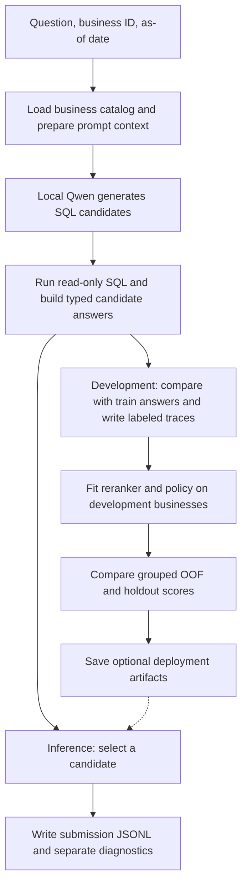

# Baseline runtime and training workflow

> Historical note: this page describes the removed text-to-SQL solver. Its module paths and CLI instructions are not runnable in the current repository. The active design proposal is in [the current harness overview](../02-harness.md).

The [archived methods notes](03-methods.md) describe proposed extensions to that solver.



## 1. What happens to one question

1. **Load the right business.** The question supplies `id`, `business_id`, `question`, and `as_of_date`. The removed catalog module loaded CSV, Excel, and SQLite data from `data/<business_id>/` into in-memory tables, normalized identifiers, and registered the tables with DataFusion.
2. **Prepare the prompt.** The removed candidate pipeline selected a bounded schema, sample values, calendar context, split rulebook and business README. It ordered schema entries by token overlap and passed `as_of_date` to Qwen for relative date resolution.
3. **Generate candidates.** The removed GGUF adapter asked Qwen for JSON with `sql` and `type`, with up to three sequential attempts. It skipped duplicate SQL and responses with neither SQL nor `type=unanswerable`.
4. **Execute and build answers.** The removed executor accepted one read-only `SELECT` or CTE per candidate. An answer adapter converted SQL results to typed answers; execution and conversion could fail independently.
5. **Extract candidate features.** The removed feature extractor recorded SQL validity, result shape, joins, date filters and agreement between candidates.

## 2. Collect examples, then fit the models

**Collection** used the Qwen weights to generate examples for a separate model. The [collector script](../../scripts/collect_candidates.py) reads `train/questions.jsonl`, runs the old pipeline and compares candidate answers with `train/answers.jsonl` using a local evaluator that has since been removed. It writes one JSONL record per question, including questions with zero retained candidates.

| Field | What it records |
| --- | --- |
| `id`, `business_id`, `question`, `reference` | The question and its reference answer. The reference is used for labeling and scoring. |
| `candidates[].sql`, `type`, `answer`, `result` | The generated SQL, typed candidate answer, execution details, and any SQL error. |
| `candidates[].features` | The signals available to the reranker at inference time. |
| `candidates[].label` | `1` if the answer matches the reference, `0` otherwise. An unusable candidate also receives `0`. |
| `candidates[].reward` | `+1` for a match, `-1` for an incorrect prediction, and `0` when there is no usable answer. |
| `generation_elapsed_ms` | Time per question, including any first catalog load, prompt preparation, model calls, SQL execution, and labeling. `candidates[].result.elapsed_ms` measures the SQL execution separately. |

For example, suppose the reference says five cups of peach tea were sold. A candidate that sums the quantity for peach tea and returns `5` gets label `1`. A candidate that counts two order lines instead gets label `0`, even if its SQL executes successfully. This is the difference the reranker tries to learn from candidate features.

**Fitting and evaluation** used the [experiment script](../../scripts/evaluate_experiment.py) to read saved traces and fit a logistic-regression reranker and optional candidate policy. This script depends on the removed package and is not a current runnable workflow.

The [seed-2026 manifest](../../configs/splits/seed_2026.json) keeps all questions from one business in the same group. The archived workflow collected all 3,000 questions and compared strategies within development folds. Its holdout numbers are historical and must not be presented as current system performance. Keep public-test results out of fitting and configuration selection.

The metrics report compares the first retained candidate, heuristic selection from the larger pool, reranking, and policy replay. The report calls the first strategy `greedy_n1`, although the first retained candidate can come from a later generation attempt. The primary score is Penalized Accuracy (PA), calculated as `(correct − wrong) / total questions`. The report also includes `oracle_at_3`, the fraction of questions with at least one correct candidate in the saved pool. Use this alongside the selected-answer results to distinguish missing correct candidates from selection errors. The evaluator writes `artifacts/reranker.joblib` and `artifacts/policy.joblib`. A file contains `None` when its component does not meet the script's enablement criteria.

## 3. Run and monitor the experiment

From the repository root, with the training kit and GGUF weights in place, run these PowerShell commands. The output directory keeps each run's traces and metrics separate.

```powershell
uv sync --locked
$run = "artifacts/full_train_$(Get-Date -Format yyyyMMdd_HHmmss)"
uv run python scripts/collect_candidates.py --candidates 3 --output "$run/train_candidates.jsonl"
```

For a quick check, pass `--limit 10 --candidates 1` and use a separate output path. `--limit` takes the first rows in file order. Use the complete trace set for the grouped experiment. After the collector exits successfully and the trace contains 3,000 question records, run the second command in the same PowerShell session.

```powershell
uv run python scripts/evaluate_experiment.py `
    --candidates "$run/train_candidates.jsonl" `
    --manifest configs/splits/seed_2026.json `
    --output "$run/experiment_metrics.json"
```

The metrics path is per run. The evaluator still writes both `.joblib` files at the root of `artifacts/` and can replace files from an earlier experiment. The collector and evaluator are separate commands. A launcher can run them in sequence after validating that collection completed.

To check progress from another PowerShell terminal, set `$run` to the active run directory and count the completed records.

```powershell
$run = 'artifacts/full_train_YYYYMMDD_HHMMSS'
(Get-Content -LiteralPath "$run/train_candidates.jsonl" | Measure-Object -Line).Lines
```

The collector flushes each completed question to disk and prints progress every 25 questions. With three attempts, the full run can make up to 9,000 sequential Qwen calls. The default runtime uses the CPU and disables prompt-prefix caching, so the shared prompt context is processed again on each attempt. Compare `generation_elapsed_ms` with the saved SQL timings to see where time is going. The trace does not report separate prompt-processing and token-generation times.

If a local launcher writes `status.txt`, `collecting` means it is generating and labeling candidates, and `fitting_and_evaluating` means it has moved on to the experiment script. The standalone collector does not create a status file.

To stop collection, interrupt the terminal running the collector. Complete records remain available for inspection. Check the last line for valid JSON before reusing a stopped trace. The collector opens its output in write mode and has no resume support. Use a fresh output path when restarting to preserve the earlier trace. An interrupted run can be used for debugging, while its coverage across the fixed groups must be checked before interpreting evaluation metrics.

## 4. Produce an inference submission

The argument-free [`predict.sh`](../../predict.sh) ran `python -m datamate` inside the evaluator. It read `/data/questions.jsonl` and business packages under `/data/data/`, then wrote typed answers to `/result/submission.jsonl` and diagnostics under `/result/logs/`. The current script still points to a module that has been removed, so this is a historical contract rather than a working runner.

The agent returns the first candidate with a usable answer in the selected order. The order is generation order when no reranker is loaded. The agent returns `abstain` if no candidate provides a usable answer or if processing raises an exception. The current inference policy callback controls whether to keep generating. Its `abstain` action can stop generation, but final answer selection still takes the first usable candidate. Offline policy replay handles `abstain` explicitly, so its score does not establish equivalent end-to-end inference behavior.

See the [archived package architecture](05-package-architecture.md) and [archived workplan](04-workplan.md) for the old implementation design and milestones.
